<div align="center">

<a href="https://audixo.tiers.rest/" title="Open the official AUDIXO website">
  
</a>

<p>
  <a href="https://audixo.tiers.rest/"><strong>Launch AUDIXO</strong></a>
  &nbsp; · &nbsp; <a href="https://audixo.tiers.rest/editor">Open Studio</a>
  &nbsp; · &nbsp; <a href="https://audixo.tiers.rest/tools/vocals">Vocal Extractor</a>
  &nbsp; · &nbsp; <a href="https://audixo.tiers.rest/tools/social-video-downloader">MP3 / MP4 Tools</a>
  &nbsp; · &nbsp; <a href="https://audixo.tiers.rest/features">Explore Features</a>
</p>

<sub>Official domain: <a href="https://audixo.tiers.rest/">audixo.tiers.rest</a> · Free browser-based audio studio · No subscription required</sub>

</div>

<details>
<summary><strong>About AUDIXO and its tools</strong></summary>

AUDIXO is a browser-based audio studio for recording, trimming, arranging tracks, adjusting effects and exporting finished mixes. Its supported workflows include a multitrack Studio, microphone recording, a five-layer vocal/instrument separator, a local mix library, and first-party MP3/MP4 conversion for authorized source media.

**Explore the live tools:** [Studio](https://audixo.tiers.rest/editor) · [Recorder](https://audixo.tiers.rest/tools/recorder) · [Vocal Extractor](https://audixo.tiers.rest/tools/vocals) · [Trim](https://audixo.tiers.rest/tools/trim-audio) · [Echo](https://audixo.tiers.rest/tools/echo) · [Pitch](https://audixo.tiers.rest/tools/pitch) · [Slowed + Reverb](https://audixo.tiers.rest/tools/slowed-reverb) · [Library](https://audixo.tiers.rest/library).

The README artwork is an illustrative overview of the product interface; the website itself is the authoritative view of current controls and capabilities.

</details>

<details>
<summary><strong>Run locally</strong></summary>

Requires Node.js 22.x, npm, a modern browser and internet access for build-time media binaries.

```bash
git clone https://github.com/mhadiglobel-bot/audixo.git
cd audixo
npm install
npm run dev
```

The Vite development server normally runs at http://localhost:5173. The first-party media API requires corresponding server-side configuration.

| Command | Purpose |
| --- | --- |
| `npm run typecheck` | Validate TypeScript |
| `npm run test:ui` | Run UI and SEO checks |
| `npm run test:media` | Run media-service tests |
| `npm run build` | Build, prerender and run release checks |
| `npm run preview` | Preview the built `dist/` locally |

</details>
