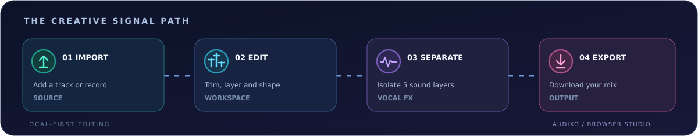

<p align="center">
  <a href="https://audixo.tiers.rest/" title="Launch AUDIXO Online Audio Studio">
    
  </a>
</p>

<div align="center">


### Your sound. Your workspace. Your rules.

**A free, browser-based audio studio for recording, precision editing, vocal separation, sound effects and exporting finished audio.**

[**Launch AUDIXO**](https://audixo.tiers.rest/) &nbsp; | &nbsp; [**Open Studio**](https://audixo.tiers.rest/editor) &nbsp; | &nbsp; [**Extract Vocals**](https://audixo.tiers.rest/tools/vocals) &nbsp; | &nbsp; [**MP3 / MP4 Downloader**](https://audixo.tiers.rest/tools/social-video-downloader)

<br />


<sub>Official production URL: <a href="https://audixo.tiers.rest/">https://audixo.tiers.rest</a> &nbsp;|&nbsp; No subscription required for the audio studio.</sub>

</div>

---

## A modern studio, directly in your browser

AUDIXO brings focused audio tools into one creative workspace. Start with a quick edit or move into a multitrack timeline, where each layer has its own controls. Use the sound playground for instant previews, separate a recording into stems, or keep finished mixes in your on-device library.

| Workspace | Create with it | Open |
|:--|:--|:--|
| **Multitrack Studio** | Import audio, arrange clips, trim, adjust levels, apply effects and export a mix. | [Launch studio](https://audixo.tiers.rest/editor) |
| **Vocal Extractor** | Split supported audio into vocals, music, drums, bass and other instruments; adjust individual layers. | [Open vocals](https://audixo.tiers.rest/tools/vocals) |
| **Audio Recorder** | Record from your microphone, pause/resume, preview and send a take to the Studio. | [Start recording](https://audixo.tiers.rest/tools/recorder) |
| **Quick Audio Tools** | Trim audio and explore echo, pitch, slowed/reverb and spatial effects. | [Trim audio](https://audixo.tiers.rest/tools/trim-audio) |
| **Social Video Downloader** | Download supported, authorized media as MP3/MP4 when the source and processing service allow it. | [Open downloader](https://audixo.tiers.rest/tools/social-video-downloader) |
| **Local Library** | Reopen and manage mixes saved in this browser on this device. | [Open library](https://audixo.tiers.rest/library) |

<details>
<summary><strong>What makes AUDIXO different?</strong></summary>

- **Original-aware editing:** the source waveform remains visible while the active trim/edit region changes.
- **Track-level control:** apply adjustments to selected audio or individual extracted stems rather than changing everything at once.
- **Practical exports:** the editor supports finished audio export; available formats and results depend on the specific tool and source.
- **Local-first workflow:** several editing features and the saved-mix library operate in your browser. Third-party media conversion uses a server-side flow.
- **Focused tools, shared identity:** one AUDIXO experience for the playground, Studio, vocals and downloader.

</details>

## From first take to finished sound

<p align="center">
  
</p>

> **Built for exploration.** First-time AI stem separation can involve a large model download and significant browser processing. Processing time and output quality vary with the track and device.

## Technology

| Layer | Main technologies |
|:--|:--|
| **UI** | React 18, TypeScript 5.6, Vite 5 |
| **Audio processing** | Web Audio API, browser-based editing, `@breezystack/lamejs` |
| **Stem extraction** | `demucs-web`, `onnxruntime-web` |
| **Media service** | Vercel Functions, FFmpeg and verified build-time `yt-dlp` binaries |
| **Optional secure cookie storage** | Private Vercel Blob, when explicitly configured |
| **Discovery** | Prerendered page metadata, canonical URLs, `sitemap.xml`, `robots.txt` and `WebSite` structured data |

### Project layout

```text
audixo/
|-- api/                 # First-party Vercel Functions
|-- config/              # Canonical site identity and domain
|-- docs/assets/         # README motion and vector assets
|-- lib/                 # Media verification, cookie and token logic
|-- public/              # App artwork, samples, PWA assets and llms.txt
|-- scripts/             # Build preparation, SSR/SEO and regression checks
|-- src/                 # React app, Studio, tools and audio services
|-- tests/               # Media regression tests
|-- vercel.json          # Routing, deployment and function settings
`-- package.json         # Scripts and dependencies
```

## Run locally

**Requirements:** Node.js **22.x**, npm, and a modern browser. Some build steps download verified media-processing binaries, so a working internet connection is required for a full production build.

```bash
git clone https://github.com/mhadiglobel-bot/audixo.git
cd audixo
npm install
npm run dev
```

Open the URL printed by Vite (normally `http://localhost:5173`). This starts the frontend development server. **Media API routes are separate Vercel Functions**; the Vite development configuration proxies `/api` to `http://127.0.0.1:8787`, so external-media download tests also require the corresponding local function environment.

| Command | Purpose |
|:--|:--|
| `npm run dev` | Start the Vite development server. |
| `npm run typecheck` | Run TypeScript checks. |
| `npm run test:ui` | Check UI and sound-carousel contracts. |
| `npm run test:media` | Run mock media-service regression checks. |
| `npm run build` | Prepare runtime assets, build the app and prerender SEO pages with release checks. |
| `npm run preview` | Serve an already-built `dist/` locally. |

## Deploy to Vercel

AUDIXO is set up as **one Vercel project** for the Vite/React frontend and its first-party API routes. You do not need to deploy a second application merely to run the media endpoints.

| Project setting | Value |
|:--|:--|
| Framework | **Vite** |
| Runtime | **Node.js 22.x** |
| Build command | `npm run build` |
| Output directory | `dist` |
| Production domain | `https://audixo.tiers.rest` |
| Functions and redirects | Defined in [`vercel.json`](vercel.json) |

1. Import the repository into Vercel and keep the **repository root** as the project root (not a static-only `dist/` upload).
2. Use the existing project configuration and attach/verify your production domain.
3. Configure only the server-side environment variables needed for the features you intend to use. Do **not** place passwords or tokens in any `VITE_*` variable.
4. Deploy from your reviewed GitHub branch. Confirm that the build, prerender, regression checks and essential pages are healthy before promotion.
5. For indexing, submit [`sitemap.xml`](https://audixo.tiers.rest/sitemap.xml) in [Google Search Console](https://search.google.com/search-console) and [Bing Webmaster Tools](https://www.bing.com/webmasters/).

The production origin is centralized in [`config/audixo-domain.json`](config/audixo-domain.json). Do not replace it with a deployment-preview URL. The legacy `audixo.vercel.app` hostname permanently redirects to the official domain.

<details>
<summary><strong>Server-side configuration and secure operations</strong></summary>

| Variable | Use |
|:--|:--|
| `AUDIXO_COOKIE_PASSWORD` | Admin access to the optional cookie-management route. Required only when using that feature. |
| `AUDIXO_SIGNING_SECRET` | Recommended private secret for expiring media-download tokens. |
| `BLOB_READ_WRITE_TOKEN` | Provided when a **private** Vercel Blob store is connected for cookie persistence. |
| `VITE_SUPPORT_EMAIL_ENABLED` / `VITE_SUPPORT_EMAIL` | Optional public-facing support contact; enable only with an actual mailbox. |

The administrative cookie route is `/bhai-cookie-dalde`. Keep it protected, use only accounts/cookies you are authorized to manage, and never commit real cookies or credentials to Git. Use the [`.env.example`](.env.example) file as an environment-variable reference.

**Media routes** in the same Vercel deployment:

```text
GET   /api/media?action=health
POST  /api/media?action=meta
POST  /api/media?action=start
GET   /api/media?action=file&token=...
```

Media conversion relies on the source provider, server resources and verified available formats. FFmpeg/yt-dlp preparation is part of the Vercel build workflow. Function duration, upstream access and large-file constraints may prevent a particular download even when a format is listed.

</details>

## Responsible use and limitations

- Download or process third-party content **only when you have permission** and the relevant platform terms allow it. AUDIXO does not promise access to restricted, private or DRM-protected content.
- A 320 kbps MP3 encoding target cannot increase the fidelity of a lower-quality source. MP4 resolutions depend on the source's verified formats.
- Large stem models and longer tracks may demand more memory and processing time than some browsers or mobile devices can provide.
- The **Local Library is device/browser-specific**, not an automatic cloud backup. Clearing browser storage can remove saved mixes.
- Build tests cover defined regressions; they do not guarantee every external video source, network, region or codec will work.

## Help and project resources

[**Help Center**](https://audixo.tiers.rest/help) &nbsp; | &nbsp; [**FAQ**](https://audixo.tiers.rest/faq) &nbsp; | &nbsp; [**Features**](https://audixo.tiers.rest/features) &nbsp; | &nbsp; [**How it works**](https://audixo.tiers.rest/how-it-works) &nbsp; | &nbsp; [**Privacy**](https://audixo.tiers.rest/privacy) &nbsp; | &nbsp; [**Terms**](https://audixo.tiers.rest/terms)

<details>
<summary><strong>About the README artwork</strong></summary>

The hero and workflow use editable SVG assets: [`audixo-hero.svg`](docs/assets/audixo-hero.svg) and [`audixo-workflow.svg`](docs/assets/audixo-workflow.svg). They include lightweight vector motion for viewers that support it, and remain legible as static graphics when GitHub or a browser disables SVG animation. No scripts or external assets are required for the artwork.

</details>

---

<p align="center">
  <sub>Made for creators who want to shape their own sound.</sub><br />
  <strong>AUDIXO</strong> &nbsp; | &nbsp; <a href="https://audixo.tiers.rest/">audixo.tiers.rest</a>
</p>