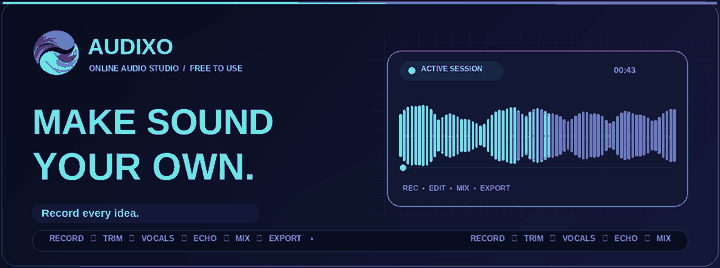
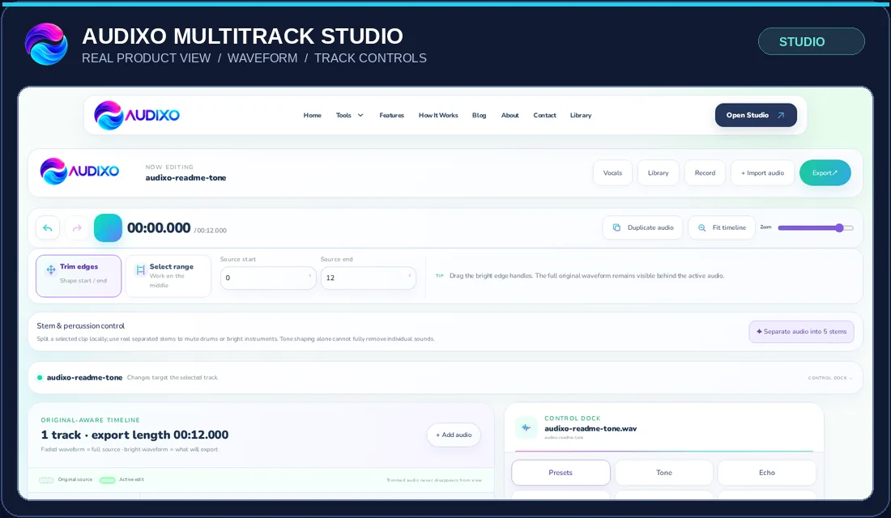
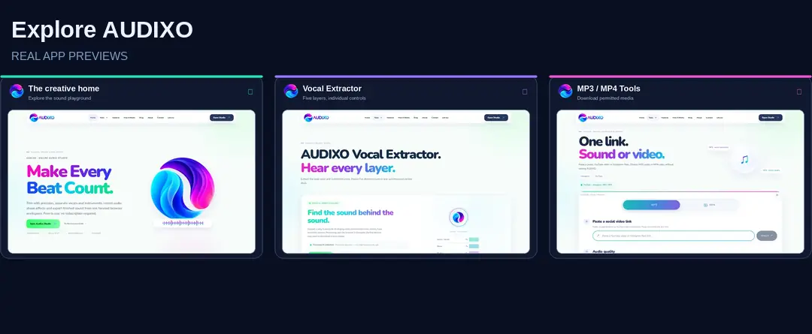

### Make every sound your own.

**Record. Edit. Separate. Remix. Export.**  
A free online audio studio built for creators, directly in your browser.

  <a href="https://audixo.tiers.rest/"><b>Launch AUDIXO</b></a>
  &nbsp; · &nbsp; <a href="https://audixo.tiers.rest/editor">Open Studio</a>
  &nbsp; · &nbsp; <a href="https://audixo.tiers.rest/tools/vocals">Extract Vocals</a>
  &nbsp; · &nbsp; <a href="https://audixo.tiers.rest/features">Explore Features</a>

Official site: <a href="https://audixo.tiers.rest/">audixo.tiers.rest</a> · No audio-studio subscription required

---

## The workspace, not just the code

These are screenshots of the **real AUDIXO website**. The pictures link to the live tools.

  

<b>MULTITRACK STUDIO</b> · Original-aware editing · Trim &amp; arrange · Track effects · Export

  

  <a href="https://audixo.tiers.rest/">Home</a> &nbsp; | &nbsp;
  <a href="https://audixo.tiers.rest/tools/vocals">Vocal Extractor</a> &nbsp; | &nbsp;
  <a href="https://audixo.tiers.rest/tools/social-video-downloader">MP3 / MP4 Downloader</a>

### What can you create?

**🎛️ Multitrack audio.** Import, trim, arrange, adjust individual tracks and export a mix. [Enter Studio](https://audixo.tiers.rest/editor)

**🎤 Record a take.** Capture microphone audio, pause, resume, preview and add it to the timeline. [Audio Recorder](https://audixo.tiers.rest/tools/recorder)

**🎼 Five sound layers.** Separate supported audio into vocals, music, drums, bass and other instruments; shape each layer independently. [Vocal Extractor](https://audixo.tiers.rest/tools/vocals)

**✨ Sound effects.** Explore [Trim](https://audixo.tiers.rest/tools/trim-audio), [Echo](https://audixo.tiers.rest/tools/echo), [Pitch](https://audixo.tiers.rest/tools/pitch), [Slowed + Reverb](https://audixo.tiers.rest/tools/slowed-reverb) and [Spatial Motion](https://audixo.tiers.rest/tools/spatial-motion).

**📥 MP3 / MP4.** Download supported, authorized public media when the source and processing service permit it. [Media Downloader](https://audixo.tiers.rest/tools/social-video-downloader)

**📚 Local Library.** Reopen and manage compatible saved mixes on the same browser and device. [My Library](https://audixo.tiers.rest/library)

---

## From first recording to final mix

  

> Audio editing and the saved-mix library use a local-first browser workflow. Five-stem separation can require a large first-time model download. External media conversion uses first-party server functions and depends on available source formats.

### Made with real audio technology

  <b>React</b> · <b>TypeScript</b> · <b>Vite</b> · <b>Web Audio</b> · <b>Demucs / ONNX Runtime Web</b> · <b>FFmpeg</b> · <b>Vercel</b>

The codebase includes the full AUDIXO site, editor, effects and first-party media functions—not a static design sample.

---

## For developers

All technical setup is kept below so the README starts with the actual product. Expand a section when you need it.

<b>Local development and commands</b>

 

Requires **Node.js 22.x**, npm and a modern browser.

~~~bash
git clone https://github.com/mhadiglobel-bot/audixo.git
cd audixo
npm install
npm run dev
~~~

The local Vite frontend normally starts at http://localhost:5173. Media API operations require the matching Vercel function environment.

- <code>npm run typecheck</code> — check TypeScript.
- <code>npm run test:ui</code> — run UI and SEO self-tests.
- <code>npm run test:media</code> — run mock media-service tests.
- <code>npm run build</code> — prepare binaries, build, prerender and validate release output.
- <code>npm run preview</code> — inspect the built application locally.

Some build steps retrieve verified binaries and runtime assets. An internet connection is required for a full production build.

<b>One-project Vercel deployment</b>

 

The Vite frontend and first-party API functions deploy together as one project. Import the **repository root**, not only the dist folder.

**Production:** https://audixo.tiers.rest  
**Framework:** Vite · **Node:** 22.x · **Build:** <code>npm run build</code> · **Output:** <code>dist</code>

Vercel configuration: [vercel.json](vercel.json) · Canonical site identity: [config/audixo-domain.json](config/audixo-domain.json)

**Server-side secrets:** The optional cookie management flow uses <code>AUDIXO_COOKIE_PASSWORD</code>; expiring download tokens can use <code>AUDIXO_SIGNING_SECRET</code>; a private Vercel Blob store provides <code>BLOB_READ_WRITE_TOKEN</code> when configured. Never commit credentials or place private secrets in <code>VITE_*</code> variables.

First-party API actions: <code>/api/media?action=health</code>, <code>meta</code>, <code>start</code> and <code>file</code>. The private administrative cookie page is <code>/bhai-cookie-dalde</code>; use only accounts and cookies you are authorized to manage.

<b>Repository folders</b>

 

~~~text
api/       First-party Vercel endpoints
config/    Canonical domain / site identity
docs/      README media and real page screenshots
lib/       Server media and security modules
public/    Brand, PWA and static assets
scripts/   Build and regression checks
src/       React website and creative tools
tests/     Media-service tests
~~~

<b>Editable SVG artwork and motion compatibility</b>

 

The animated banners above are **real looping GIF files**, rather than SVG animations that GitHub may display as static.

Editable vector sources are also retained in this repository: [Hero SVG](docs/assets/audixo-hero.svg) and [Creative workflow SVG](docs/assets/audixo-workflow.svg). The README uses GIFs for reliable playback on GitHub. For original brand identity, the artwork uses the official AUDIXO app logo.

<b>Responsible use, limitations and search visibility</b>

 

- Download and process third-party content only with permission and in accordance with the relevant platform rules.
- External media services, formats, server processing limits and network restrictions may prevent individual downloads.
- A 320 kbps MP3 encoding target cannot restore fidelity missing from a lower-quality source.
- Browser-based stem processing can be demanding on mobile devices; your Local Library is not automatic cloud backup.
- Search metadata includes canonical links, a sitemap, robots rules and website identity schema. Google and Bing determine when indexing and search appearance change.
- The animations in this README are actual looping GIF files; decorative artwork is not a representation of guaranteed audio processing performance.

---

### Hear every possibility.

<a href="https://audixo.tiers.rest/editor"><b>Start creating with AUDIXO</b></a> &nbsp; · &nbsp;
<a href="https://audixo.tiers.rest/help">Help</a> &nbsp; · &nbsp;
<a href="https://audixo.tiers.rest/faq">FAQ</a> &nbsp; · &nbsp;
<a href="https://audixo.tiers.rest/privacy">Privacy</a>

  

 

Official brand artwork · Real application previews · GitHub-compatible motion graphics

